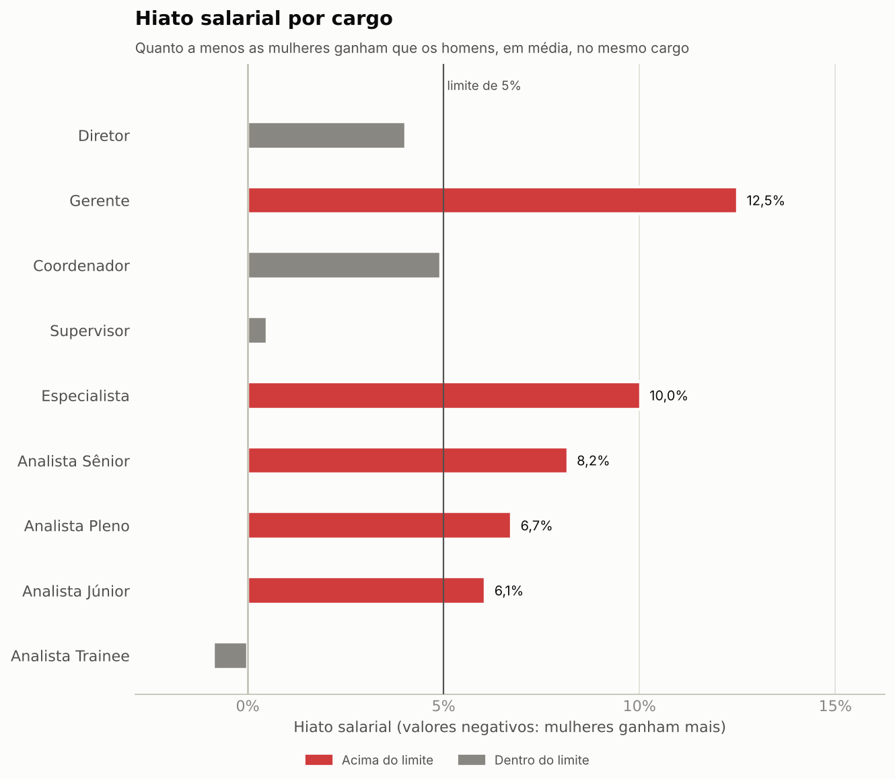
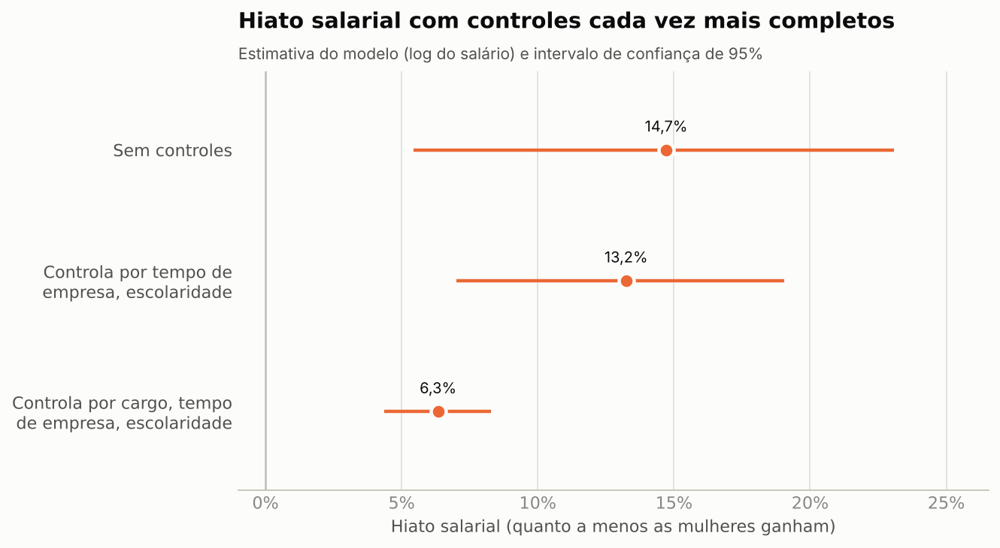
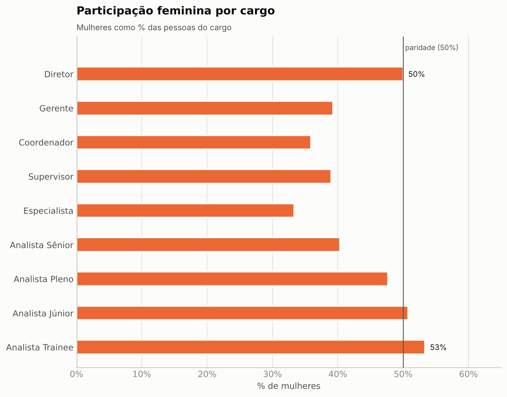

# Monitor de Equidade Salarial

Painel e biblioteca em Python para medir o **hiato salarial de gênero** em uma base de colaboradores: quanto a menos as mulheres ganham, em quais cargos a diferença passa de um limite e quanto dela sobra depois de comparar pessoas com o mesmo cargo, tempo de empresa e escolaridade.

Começou como trabalho da disciplina de Gestão e Qualidade de Software (IBMR) e foi refeito do zero como projeto de análise de dados.

**[Abrir o painel online](https://equidade-salarial-gqs.streamlit.app/)** (dados fictícios). Se aparecer a tela "This app has gone to sleep", clique no botão para acordar o app; leva alguns segundos.

> **Os dados de exemplo são fictícios.** Foram gerados por `scripts/gerar_dados_exemplo.py` com regras explícitas (ver [docs/metodologia.md](docs/metodologia.md)). Os números abaixo descrevem essa base inventada, não o mercado de trabalho.

## O que ele responde

1. **Existe diferença?** Hiato bruto nas médias e nas medianas, com alerta quando passa do limite escolhido (padrão: 5%).
2. **Onde?** Hiato por cargo, com aviso quando o cargo tem poucas pessoas para comparar.
3. **Por quê?** Parte da diferença vem de mulheres estarem em cargos mais baixos. Uma regressão sobre o log do salário separa essa parte da diferença que sobra no mesmo cargo, com intervalo de confiança.

## Resultados na base de exemplo

400 colaboradores (223 homens e 177 mulheres), 9 cargos.

| Medida | Resultado |
|---|---|
| Hiato nas médias | 13,7% |
| Hiato nas medianas | 24,6% |
| Cargos acima do limite de 5% | 5 de 9 (Gerente 12,5%, Especialista 10,0%, Analista Sênior 8,2%, Analista Pleno 6,7%, Analista Júnior 6,1%) |
| Hiato ajustado (cargo, tempo de empresa e escolaridade) | 6,3% (IC 95%: 4,4% a 8,3%) |

O hiato bruto é maior que o ajustado porque as mulheres da base estão mais concentradas nos cargos de menor salário. A base foi gerada com uma diferença de 5% a 10% no mesmo cargo (7,0% em média), e o modelo recupera esse valor dentro do intervalo de confiança.







Os gráficos acima são gerados pelo mesmo código que alimenta o painel (`python -m scripts.gerar_graficos`).

## Como rodar

Desenvolvido e testado com Python 3.13.

```bash
git clone https://github.com/jvmelllo/equidade-salarial-GQS.git
cd equidade-salarial-GQS
python -m venv .venv
source .venv/bin/activate        # no Windows: .venv\Scripts\activate
pip install -r requirements.txt

python -m streamlit run app.py   # abre o painel no navegador
python -m pytest                 # roda os testes
```

O painel abre com a base de exemplo. Na barra lateral dá para enviar um CSV próprio, mudar o limite de alerta, o mínimo de pessoas por grupo e as variáveis de controle do modelo. A última aba baixa um relatório em Excel.

### Formato do CSV

| Coluna | Obrigatória | Observação |
|---|---|---|
| `genero` | sim | `M`, `F`, `Masculino` ou `Feminino` |
| `cargo` | sim | texto livre; os cargos conhecidos (Trainee, Júnior, Pleno, Sênior, Especialista, Supervisor, Coordenador, Gerente, Diretor) são ordenados por hierarquia |
| `salario` | sim | maior que zero; aceita `4500.50` ou `R$ 4.500,50` |
| `tempo_empresa` | não | anos de casa |
| `escolaridade` | não | Ensino Médio, Superior, Pós-graduação, Mestrado ou Doutorado |

Separador `,` ou `;` é detectado sozinho. Colunas extras (como `id` ou `nome`) são ignoradas e nunca entram no relatório. Se houver linhas inválidas, o erro diz em quais linhas do arquivo estão.

> Não envie dados reais de pessoas para uma versão publicada do painel. Para analisar a folha de uma empresa, rode o projeto na sua máquina.

## Estrutura

```
app.py                      painel Streamlit (só orquestra as funções abaixo)
equidade/
  dados.py                  leitura, validação e normalização do CSV
  analise.py                hiato bruto, alerta e status por cargo
  modelo.py                 hiato ajustado (regressão sobre o log do salário)
  graficos.py               gráficos em Matplotlib, usados pelo painel e pelo README
  exportacao.py             relatório em Excel (só dados agregados)
  formatacao.py             números e percentuais no padrão brasileiro
scripts/
  gerar_dados_exemplo.py    gera data/dados_exemplo.csv (semente fixa)
  gerar_graficos.py         gera as imagens de docs/img
tests/                      79 testes
docs/
  metodologia.md            fórmulas, como interpretar e regras da base fictícia
  qualidade.md              qualidade do software (ISO/IEC 9126) com evidências
```

## Testes

79 testes com pytest, em cerca de 3 segundos.

| Arquivo | Testes | Cobre |
|---|---|---|
| `test_dados.py` | 33 | normalização, validação e mensagens de erro do CSV |
| `test_analise.py` | 16 | fórmula do hiato, limite de alerta, status por cargo |
| `test_modelo.py` | 13 | regressão contra o NumPy, recuperação de hiato conhecido, casos de erro |
| `test_cenarios.py` | 8 | do CSV ao relatório, pela interface pública |
| `test_graficos.py` | 6 | gráficos, inclusive com dados incompletos |
| `test_exportacao.py` | 3 | relatório em Excel |

Versões usadas nos testes: Python 3.13, pandas 3.0, NumPy 2.5, SciPy 1.18, Matplotlib 3.11 e openpyxl 3.1. Os testes cobrem a lógica de análise; o painel em si (`app.py`) não tem teste automatizado.

## Limitações

- Hiato ajustado diferente de zero **não prova discriminação**: faltam variáveis como desempenho e área, e controlar por cargo pode esconder diferenças de promoção. Por isso o painel mostra o hiato bruto e o ajustado juntos.
- O modelo é uma regressão linear sobre o log do salário, sem interações. Não há correção para comparações múltiplas entre cargos; o p-valor por cargo é só informativo.
- Gênero entra como `M` e `F`, a classificação usada nos relatórios de transparência salarial. Outras identidades ficam fora da análise.
- Os dados de exemplo são sintéticos. Com dados reais, os resultados dependem de como cada empresa define cargo e escolaridade.

## Licença

[MIT](LICENSE)
